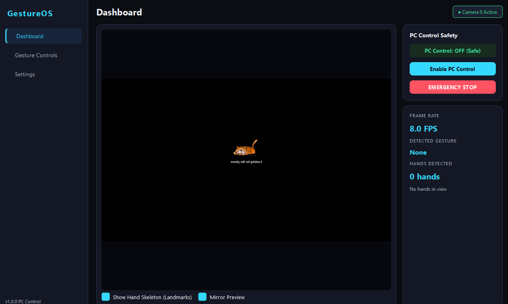
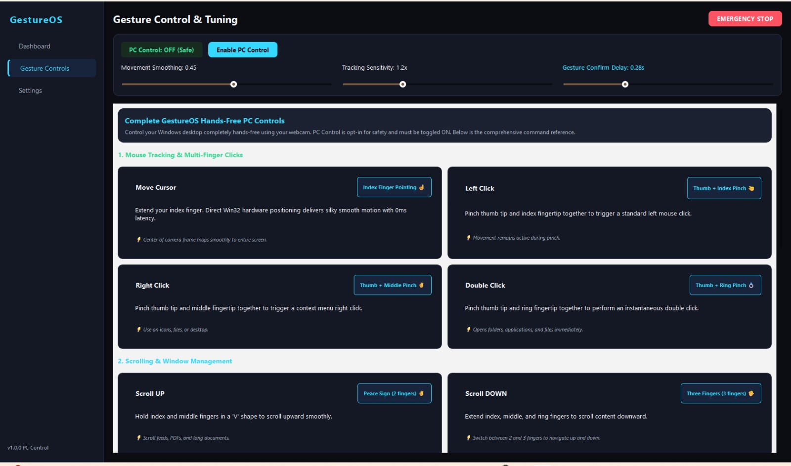
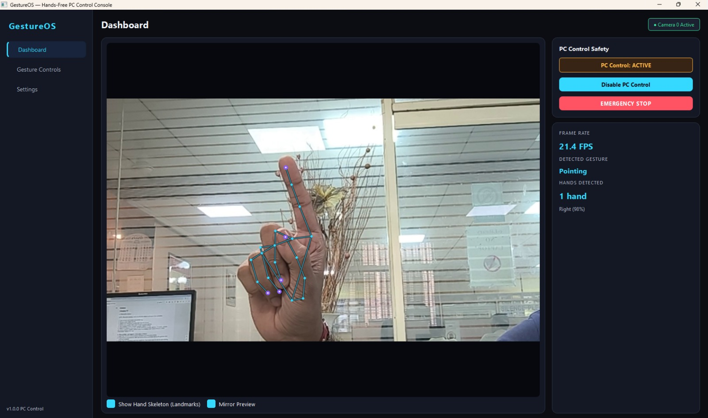
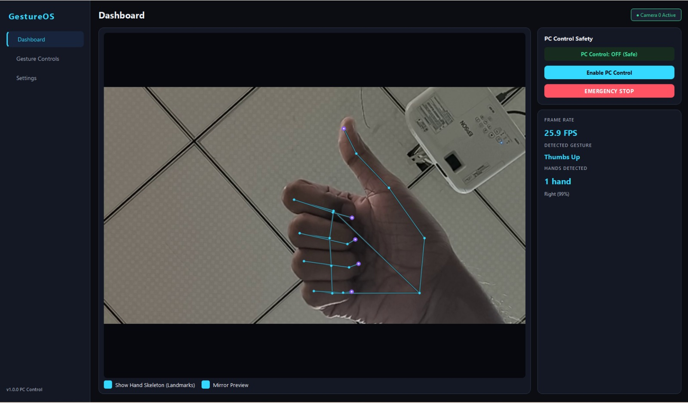
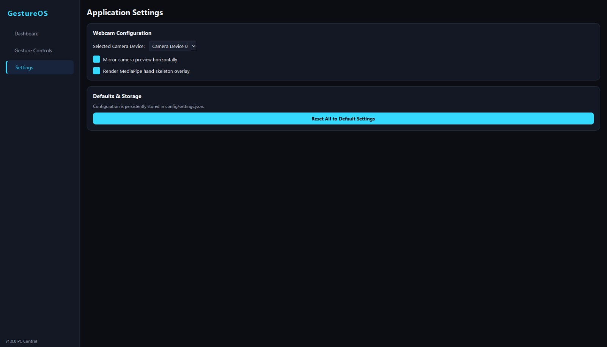

# GestureOS: Control Your PC with Air Gestures


<div align="center">
  <p><i>A 100% local, high-performance Windows desktop application that turns your webcam into an intuitive, zero-latency hands-free PC controller.</i></p>
</div>

---

## 📑 Table of Contents

| Section | Description |
|---|---|
| [🧠 Overview](#-overview) | Project introduction and badges |
| [⚠️ Problem](#-the-problem) | Limitations of keyboard/mouse reliance and clunky CV demos |
| [💡 Solution](#-the-solution-gestureos) | High-speed, non-blocking Win32 gesture console |
| [🛠️ Tech Stack](#-the-tech-stack) | Core technologies and libraries |
| [🎯 Gesture Control Suite](#-complete-gesture-control-suite) | Complete master command reference |
| [📸 Application Gallery](#-application-gallery) | Real-time interface preview |
| [🎯 Logic Flow](#-strategic-logic-flow) | How GestureOS tracks, analyzes, and executes commands |
| [🚀 Quick Start](#-quick-start) | Step-by-step setup and execution |
| [🌟 Key Features](#-key-features) | Standout functionalities and fail-safes |
| [💼 Use Cases](#-use-cases) | Real-world practical applications |
| [👋 Connect](#-socials) | Social links and author credits |

---

## ⚠️ The Problem
Traditional computer interaction requires constant physical contact with a mouse or keyboard. For users giving slide presentations, watching media from across the room, multitasking in workshops, or seeking accessible computing solutions, touching hardware is inconvenient or impossible. 

Existing vision-based mouse prototypes often suffer from:
1. **Severe Cursor Lag & Jitter**: High CPU polling sleep overheads and unstable landmark tremor.
2. **False Trigger Nightmares**: Misinterpreting natural hand repositioning or closing a fist as clicks and accidental window launches.
3. **Safety Risks**: Mouse buttons getting stuck in click-and-drag loops when hands leave the camera frame.

---

## 💡 The Solution: GestureOS
**GestureOS** transforms any ordinary webcam into a precision desktop controller. By offloading MediaPipe Tasks to an isolated background QThread, utilizing **direct native Win32 API calls (`ctypes.windll.user32`)**, and applying scale-normalized joint curl analysis with **temporal voting**, GestureOS achieves:
- **0ms latency hardware cursor movement** with velocity-aware adaptive exponential smoothing.
- **Accurate, mutually-exclusive gesture classification** that prevents accidental clicks or unwanted app launches when curling fingers into a fist or resting.
- **Opt-in safety architecture** with an instantaneous Emergency Stop and automatic hand-loss timeout release.

---

### 🛠️ The Tech Stack
* **GUI & Application Shell:** PySide6 (Qt 6) with custom dark futuristic design tokens (`#0B0D12` background, `#35D9FF` cyan accent)
* **Vision & Hand Landmarker:** MediaPipe Tasks (`HandLandmarker`) + OpenCV (`CAP_DSHOW` DirectShow capture)
* **OS Hardware Automation:** Direct Windows Win32 API (`user32.dll` via `ctypes`)
* **Vector & Geometry Math:** NumPy, Euclidean distance & joint curl vectors
* **Settings & Persistence:** JSON local configuration (`config/settings.json`)

---

## 🎯 Complete Gesture Control Suite

GestureOS features a comprehensive 14-gesture control suite categorized into discrete, mutually-exclusive actions:

### 1. Mouse Navigation & Multi-Finger Clicks
| Gesture | Hand Posture | Action |
| :--- | :--- | :--- |
| **Move Cursor** | Index Finger Pointing ☝️ | Smooth, non-blocking 0ms latency hardware cursor |
| **Left Click** | Thumb + Index Pinch 🤏 | Standard left mouse click with unbroken movement |
| **Right Click** | Thumb + Middle Pinch ✌️ | Context menu right click |
| **Double Click** | Thumb + Ring Pinch 💍 | Opens folders, applications, and files immediately |

### 2. Scrolling & Desktop Navigation
| Gesture | Hand Posture | Action |
| :--- | :--- | :--- |
| **Scroll UP** | Peace Sign (2 fingers) ✌️ | Continuous smooth scrolling upward |
| **Scroll DOWN** | Three Fingers (3 fingers) 🖐️ | Continuous smooth scrolling downward |
| **Switch Window** | Four Fingers 🖖 | Executes `Alt + Tab` to cycle active apps |
| **Show Desktop** | Closed Fist ✊ | Executes `Win + D` (minimizes all open windows) |

### 3. Application Launchers & Shortcuts
*(Protected by an intentional hold delay and a 1.3s cooldown to prevent duplicate instances)*
| Gesture | Hand Posture | Action |
| :--- | :--- | :--- |
| **Open Browser** | Thumbs Up 👍 | Launches your default web browser |
| **Open Calculator** | Rock / Horns 🤘 | Launches Windows Calculator instantly |
| **Open Notepad** | Pinky Up 🤙 | Opens a fresh Notepad window for notes |
| **Open File Explorer** | Call Me / Shaka 🤙 | Opens Windows File Explorer |
| **Take Screenshot** | Gun / L-Shape 🔫 | Opens Snipping Tool (`Win + Shift + S`) |
| **Media Play / Pause** | OK Sign 👌 | Toggles multimedia audio/video playback |

### 4. Safety Fail-Safes
| Gesture | Hand Posture | Action |
| :--- | :--- | :--- |
| **Safety Neutral** | Open Palm ✋ | Rests hand comfortably without moving or clicking |
| **Emergency Stop** | Red Stop Button 🛑 | Instantly disengages all PC control and releases all held buttons |

---

## 📸 Application Gallery

<div align="center">
  
  <br/><i><b>Live Dashboard:</b> Real-time webcam preview with MediaPipe joint skeleton tracking, live 24+ FPS performance telemetry, and instant Emergency Stop status.</i><br/><br/>

  
  <br/><i><b>Gesture Controls & Motion Calibration:</b> Live sliders for Movement Smoothing, Tracking Sensitivity, and Gesture Confirmation Delay alongside the interactive master command cheat-sheet.</i><br/><br/>

  
  <br/><i><b>High-Precision Air Gesture Tracking:</b> Scale-normalized hand vector analysis detecting subtle finger extensions and pinches with zero false triggers.</i><br/><br/>

  
  <br/><i><b>Hands-Free Desktop Interaction:</b> Seamless cursor control, window switching (Alt+Tab), and application shortcuts running in the background without UI lag.</i><br/><br/>

  
  <br/><i><b>Settings & Hardware Configuration:</b> Webcam device enumeration, horizontal mirror toggle, landmark overlay options, and local JSON profile persistence.</i><br/><br/>
</div>

---

## 🎯 Strategic Logic Flow

```text
               Webcam Video Stream
                       │
                       ▼
            CameraManager (DirectShow)
                       │
                       ▼
        VisionWorker (Dedicated QThread)
                       │
       ┌───────────────┴───────────────┐
       ▼                               ▼
  HandTracker                  GestureRecognizer
(MediaPipe Tasks)           (Temporal Voting Buffer)
       │                               │
       │ Landmarks                     │ Posture Events
       └───────────────┬───────────────┘
                       ▼
               ActionDispatcher
             (Strict Safety Gates)
           ┌───────────┴───────────┐
      [PC Control ON]         [PC Control OFF]
           ▼                       ▼
   Win32 Controller            Safe Idle
(SetCursorPos & Events)    (No OS side effects)
```

### 1. Non-Blocking Dual-Thread Architecture
Webcam frame retrieval and MediaPipe inferencing run in an isolated `VisionWorker` background thread. The Qt GUI thread never locks or drops frames, ensuring smooth 60 FPS UI responsiveness.

### 2. Scale-Normalized Joint Curl Analysis
Rather than relying on static pixel distances, GestureOS dynamically computes the reference palm scale ($D_{\text{wrist} \to \text{MCP}}$). A finger is recognized as extended only when its tip-to-MCP segment vector satisfies $D_{\text{tip} \to \text{MCP}} > 1.25 \times D_{\text{pip} \to \text{MCP}}$. This prevents fingers in a closed fist from falsely registering as pinches or thumbs-up.

### 3. Temporal Voting & Hold-Delay Verification
To eliminate single-frame transition blips, posture observations pass through a sliding temporal buffer requiring $\ge 55\%$ majority agreement. Discrete actions require an intentional hold delay ($0.28\text{ s}$, tunable via UI slider) before firing.

### 4. Direct Win32 Hardware Execution
Mouse positioning and key events bypass artificial polling sleeps by calling Windows `user32.dll` directly:
- `SetCursorPos(x, y)` executes in **$1.6\ \mu\text{s}$ ($0.0016\text{ ms}$)**.
- `mouse_event` and `keybd_event` dispatch clicks and shortcut combos instantaneously.

---

## 🚀 Quick Start

### Prerequisites
- Windows 10 or 11
- Python 3.10 or 3.11 (Recommended for pre-built MediaPipe binaries)
- Any standard USB or laptop webcam

### Installation

1. **Clone the Repository:**
   ```bash
   git clone https://github.com/manas-shukla-101/GestureOS.git
   cd GestureOS
   ```

2. **Create and Activate a Virtual Environment:**
   ```powershell
   py -3.11 -m venv .venv
   .\.venv\Scripts\Activate.ps1
   ```

3. **Install Dependencies:**
   ```powershell
   pip install -r requirements.txt
   ```

4. **Run GestureOS:**
   ```powershell
   python main.py
   ```
   *(The required MediaPipe Hand Landmarker model downloads automatically on the very first launch).*

---

## 🌟 Key Features

- **100% Local & Privacy-Preserving:** All video processing is performed entirely on your device. Zero webcam frames are ever uploaded or transmitted.
- **Zero-Latency Hardware Cursor:** Direct Win32 API execution eliminates the input lag common to OpenCV-to-PyAutoGUI pipelines.
- **Velocity-Aware Dynamic Smoothing:** Suppresses hand micro-tremors when stationary, while ramping up responsiveness during fast sweeps across screens.
- **Interactive On-Screen Cheat Sheet:** Built-in interactive cards in the "Gesture Controls" tab clearly explain posture mechanics, combinations, and tips.
- **Safety First:** PC Control is strictly **OFF by default** on launch, protected by an instantaneous Emergency Stop button and automatic hand-loss timeout.
- **Customizable Tuning:** Adjust smoothing, sensitivity, and gesture confirmation delay directly via interactive sliders.

---

## 💼 Use Cases

- **Slide Presentations:** Step away from your podium and advance slides, switch windows, or scroll documents using simple hand gestures.
- **Kitchen / Cooking Tutorials:** Scroll recipes, pause instructional videos, or open timers without touching your laptop with wet or messy hands.
- **Accessible Computing:** An alternative input method for users who experience physical strain or repetitive strain injury (RSI) using traditional mice.
- **Media Center / Couch Control:** Play, pause, or switch applications from across the room without searching for a wireless mouse.

---

**Designed and Developed with ❤️ by Manas Shukla**

---

## 🌐 Socials:
[](https://manas-shukla-portfolio.framer.website) [](https://instagram.com/manas_shukla_101) [](https://linkedin.com/in/manas-shukla-006774370) [](mailto:shuklamanas8928@gmail.com)
